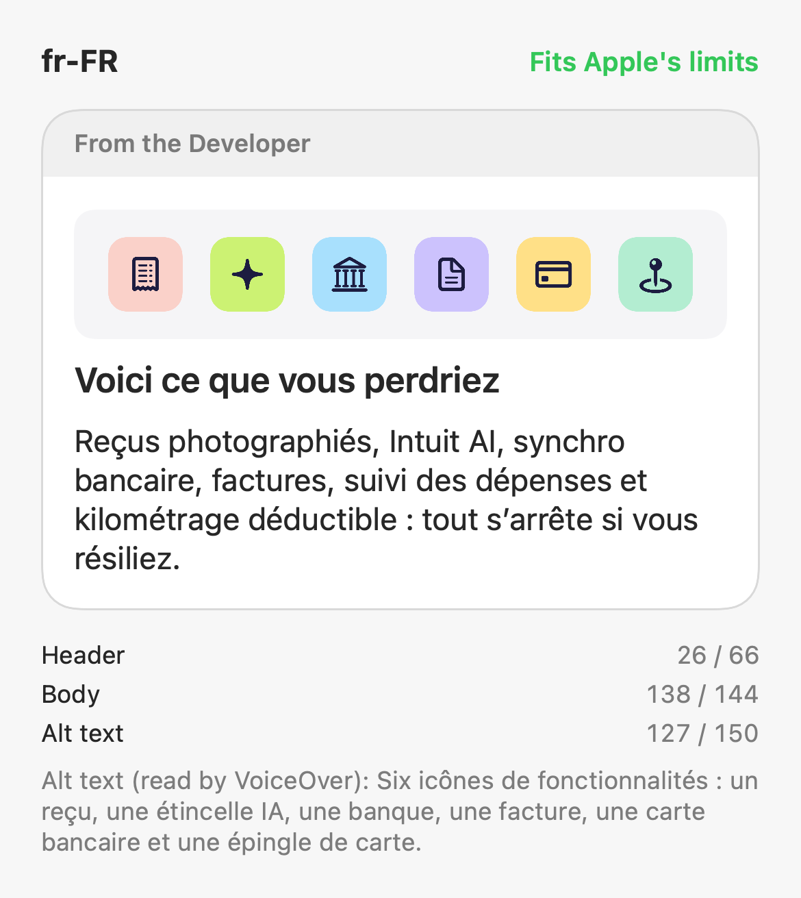

# "Here's what you'd lose" retention message

A text message with an image, built so the image works in every language. The image shows only icons; the feature names are in the body text, which is translated with the rest of the message.


| File | What it is | Upload to Apple? |
| --- | --- | --- |
| `feature-icons.png` | The icons-only image, 3840 × 760, PNG, no transparency | **Yes**, once, for every language |
| `messages.json` | Header, body, and alt text for each language | **Yes**: copy each language's text into App Store Connect |
| `Previews/<locale>.png` | How each language looks in the "From the Developer" card, with character counts | **No**, for review only |

## Text for each language

All text lives in `messages.json`. Apple's limits apply to each language: header 66, body 144, alt text 150 characters.

| Locale | Header | Body | Alt text |
| --- | --- | --- | --- |
| en-US | 22 / 66 | 126 / 144 | 94 / 150 |
| fr-FR | 26 / 66 | 138 / 144 | 127 / 150 |
| fr-CA | 26 / 66 | 137 / 144 | 127 / 150 |

English:

- **Header:** Here's what you'd lose
- **Body:** Snap receipts, Intuit AI, bank syncing, invoices, bill tracking, and trip mileage for tax deductions all stop when you cancel.
- **Alt text:** Six feature icons: a receipt, an AI sparkle, a bank, an invoice, a credit card, and a map pin.

French differs between France ("si vous résiliez") and Canada ("si vous annulez"). French puts a non-breaking space before ":", stored as ` ` in `messages.json`. Have a native speaker review translations before submitting, so feature names match what the app calls them.



## The icons

The icons appear left to right in the same order as the features in every body text:

| Icon | SF Symbol | Feature |
| --- | --- | --- |
| Receipt (salmon) | `receipt` | Snap receipts |
| Sparkle (lime) | `sparkle` | Intuit AI |
| Bank (sky blue) | `building.columns` | Bank transactions |
| Document (lavender) | `doc.text` | Invoices |
| Card (yellow) | `creditcard` | Expenses and bills |
| Map pin (mint) | `mappin.and.ellipse` | Trips |

## Regenerating

From the project folder:

```sh
swift Scripts/render-retention-image.swift              # check text, render image and previews
swift Scripts/render-retention-image.swift --check-only # only check text lengths
```

The script:

1. Checks every language in `messages.json` against Apple's limits and prints the counts.
2. Renders `feature-icons.png` from the `features` list in the script.
3. Renders `Previews/<locale>.png` for each language.

It exits with status 1 if any text is too long, so it can run in CI.

**To add a language,** add an entry to `messages.json` with its locale, header, body, and alt text, then run the script. **To change the icons,** edit `features` in the script, then update every body and alt text so the order still matches, and resubmit for review.

Counts are in characters (Swift `String.count`). Apple's docs give limits for UTF-8 strings without saying whether they count characters or bytes, so leave a little room for accented languages.
