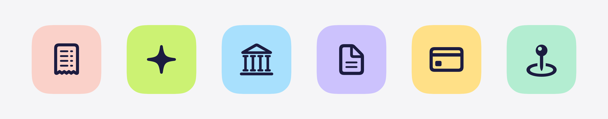

# "Here's what you'd lose" retention message

A text message with an image, built so the image works in every language. The image shows only icons; the feature names are in the body text, which is translated with the rest of the message.



## What to enter in App Store Connect

| Field | Text | Length |
| --- | --- | --- |
| Header | Here's what you'd lose | 22 / 66 |
| Body | Snap receipts, Intuit AI, bank syncing, invoices, bill tracking, and trip mileage for tax deductions all stop when you cancel. | 126 / 144 |
| Image | `feature-icons.png` (3840 × 760, PNG, no transparency) | — |
| Image alt text | Six feature icons: a receipt, an AI sparkle, a bank, an invoice, a credit card, and a map pin. | 94 / 150 |

The icons appear left to right in the same order as the features in the body:

| Icon | SF Symbol | Feature |
| --- | --- | --- |
| Receipt (salmon) | `receipt` | Snap receipts |
| Sparkle (lime) | `sparkle` | Intuit AI |
| Bank (sky blue) | `building.columns` | Bank transactions |
| Document (lavender) | `doc.text` | Invoices |
| Card (yellow) | `creditcard` | Expenses and bills |
| Map pin (mint) | `mappin.and.ellipse` | Trips |

## Translating

- Upload **one** image and use it for every language.
- Translate the header, body, and alt text per language, within the same limits: 66, 144, and 150 characters. Languages like German and French run longer, so shorten feature names there if needed, keeping the order matched to the icons.
- Keep "Intuit AI" as is if it's a product name.

## Changing the image

Edit the `features` list in `Scripts/render-retention-image.swift`, then run:

```sh
swift Scripts/render-retention-image.swift
```

It writes `Docs/RetentionAssets/feature-icons.png`. If you change the icons or their order, update the body text and alt text to match, and resubmit for review.
