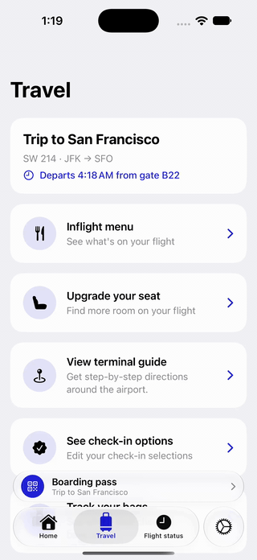

# SkyWay

An iOS sample project for exploring SwiftUI tab bar placements in the Liquid Glass design: a tab bar **bottom accessory**, **minimize on scroll**, and a **prominent tab** pinned to the trailing edge.

## Demo

| Tab bar bottom accessory | Prominent tab |
| --- | --- |
|  |  |
| Scrolling minimizes the tab bar and the boarding pass moves inline. It only appears on the Travel tab, and tapping it opens the boarding pass. | The `.prominent` tab sits in its own glass button on the trailing side and stays put when the tab bar minimizes. |

## Features

| Feature | API | Where |
| --- | --- | --- |
| Boarding pass bar above the tab bar, shown only on the Travel tab | `tabViewBottomAccessory(isEnabled:content:)` | `App/ContentView.swift` |
| Tab bar collapses when scrolling down; the accessory moves inline beside it | `tabBarMinimizeBehavior(.onScrollDown)` | `App/ContentView.swift` |
| Accessory adapts its layout when inline vs. expanded | `@Environment(\.tabViewBottomAccessoryPlacement)` | `App/BoardingPassAccessory.swift` |
| Dedicated tab in its own glass button on the trailing side | `Tab(..., role: .prominent)` (iOS 27) or `role: .search` | `App/ContentView.swift` |
| Boarding pass sheet with a generated QR code | `CIFilter.qrCodeGenerator()` | `App/BoardingPassView.swift` |
| Siri onscreen awareness for the trip and search rows | `.userActivity` / `.appEntityIdentifier` + `AppEntity` | `App/TripEntity.swift`, `App/TravelActionEntity.swift` |
| "Where is my trip in Skyway?" Siri phrase | `AppIntent` + `AppShortcutsProvider` | `App/GetCurrentTripIntent.swift`, `App/SkywayShortcuts.swift` |

For how onscreen awareness works and when to use `.userActivity` vs `.appEntityIdentifier`, see [Docs/OnscreenAwareness.md](Docs/OnscreenAwareness.md).

## Requirements

- Xcode 27.1 or later
- iOS 27.0 or later (deployment target in `Project.json`)
- [XcodeGen](https://github.com/yonaskolb/XcodeGen) to generate the Xcode project

## Getting Started

The Xcode project is not checked in. It is generated from `Project.json` (an XcodeGen spec in JSON format).

```sh
# 1. Install XcodeGen (once)
brew install xcodegen

# 2. Clone and generate the Xcode project
git clone https://github.com/badrinathvm/SkyWay.git
cd SkyWay
xcodegen generate --spec Project.json

# 3. Open in Xcode
open Project.xcodeproj
```

Then pick the **Skyway** scheme and an iPhone simulator, and press **Run** (⌘R).

> Open `Project.xcodeproj`, not the `App` folder. Opening the folder gives Xcode no target or scheme, so there is no Run button.

Re-run `xcodegen generate --spec Project.json` whenever you add or remove files or change `Project.json`. Edits to existing Swift files don't need it.

### Troubleshooting

If builds fail with `missing DEVELOPER_DIR path`, point the command line tools at your installed Xcode:

```sh
sudo xcode-select -s /Applications/Xcode.app
```

## Project Structure

```
App/
  App.swift                    App entry point
  ContentView.swift            TabView, bottom accessory, minimize behavior
  AppTab.swift                 Tab definitions (titles and SF Symbols)
  BoardingPassAccessory.swift  Tab bar accessory view
  BoardingPassView.swift       Boarding pass sheet with QR code
  TravelView.swift             Scrollable Travel tab content
  TravelAction.swift           Travel action model and sample data
  SearchView.swift             Searchable list of travel actions
  PlaceholderTabView.swift     Placeholder for unbuilt tabs
  Trip.swift                   Trip model and sample data
  TripStore.swift              Trip data shared by the UI and App Intents
  TripEntity.swift             Trip App Entity, query, and Spotlight indexing
  TravelActionEntity.swift     Travel action App Entity and query
  GetCurrentTripIntent.swift   "Get Upcoming Trip" App Intent
  SkywayShortcuts.swift        Siri phrases (App Shortcuts)
Docs/
  OnscreenAwareness.md         Notes on Siri onscreen awareness
  *.gif                        Demo GIFs used in this README
Project.json                   XcodeGen project spec
```

## Key Snippets

Show an accessory only on one tab, and collapse the tab bar on scroll:

```swift
TabView(selection: $selectedTab) { … }
  .tabBarMinimizeBehavior(.onScrollDown)
  .tabViewBottomAccessory(isEnabled: selectedTab == .travel) {
    BoardingPassAccessory(trip: trip) { isShowingBoardingPass = true }
  }
```

Pin a tab to the trailing edge. A `.prominent` tab needs a label, otherwise iOS shows a "?" placeholder:

```swift
Tab("Settings", systemImage: "gear", value: AppTab.settings, role: .prominent) {
  SettingsView()
}

// Or with your own asset catalog image
Tab("Settings", image: "BrandMark", value: AppTab.settings, role: .prominent) { … }
```
